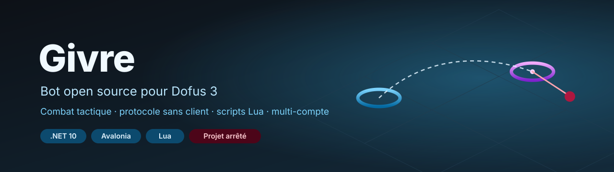
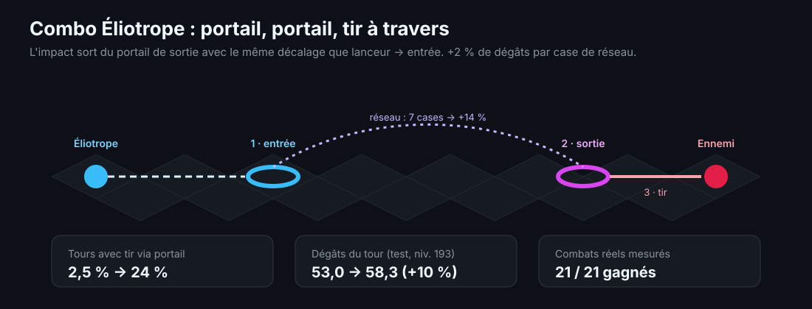
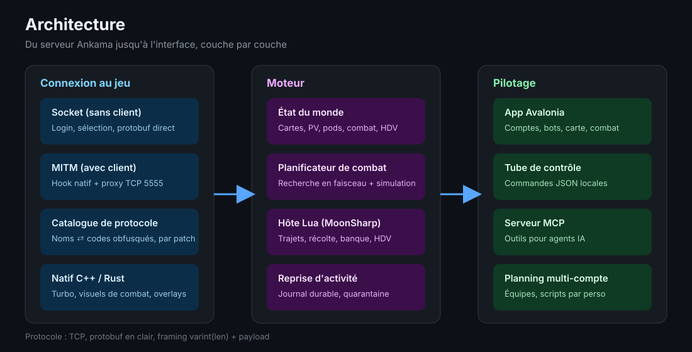

<p align="center">
  
</p>

<p align="center">
  
  
  
  
  
  
</p>

# Givre

Givre est un bot pour **Dofus 3**, le MMORPG d'Ankama, écrit en C# (.NET 10) avec une interface Avalonia.
Il joue les combats avec un vrai planificateur tactique, se connecte au serveur **sans lancer le client**,
exécute des scripts **Lua** pour le farm, la récolte, la banque et l'hôtel des ventes, et pilote plusieurs comptes.

> [!WARNING]
> **Ce projet est arrêté et publié tel quel, à des fins d'étude.**
> Automatiser Dofus est contraire aux conditions d'utilisation d'Ankama. Des comptes utilisés avec ce bot ont été
> **bannis définitivement**. N'utilise rien de ce dépôt sur un compte auquel tu tiens. Aucune aide ni mise à jour
> ne sera fournie.

## Sommaire

- [En chiffres](#en-chiffres)
- [Fonctionnalités](#fonctionnalités)
- [L'IA de combat](#lia-de-combat)
- [Architecture](#architecture)
- [Le protocole Dofus 3](#le-protocole-dofus-3)
- [Scripts Lua](#scripts-lua)
- [Compiler et tester](#compiler-et-tester)
- [Ce qu'on a appris](#ce-quon-a-appris)
- [Organisation du dépôt](#organisation-du-dépôt)
- [Licence](#licence)

## En chiffres

| | |
|---|---|
| Code C# | ~312 000 lignes, 1 666 fichiers |
| Tests | ~6 950 tests xUnit, suite complète verte au moment de l'arrêt |
| Scripts Lua fournis | 73 |
| Documentation | ~150 notes techniques dans [`docs/`](docs) |
| Classes de combat couvertes | Éliotrope, Sram, Crâ, Sadida, Xélor, Roublard, Sacrieur, Écaflip, Féca… |

## Fonctionnalités

**Connexion et comptes**
- Connexion **Socket sans client** : identification, choix du serveur et du personnage, puis jeu en protobuf direct.
- Mode **MITM** avec le vrai client : un hook natif redirige la connexion vers un proxy local qui lit et injecte les paquets.
- Gestion multi-compte, chiffrement local des identifiants (DPAPI), proxys par compte, reconnexion automatique.
- Détection du bannissement et blocage du relancement automatique.

**Combat**
- Planificateur tactique par recherche en faisceau, qui simule réellement chaque sort (dégâts, soins, boucliers,
  états, poussées, téléportations, invocations, effets différés).
- Mécaniques de classe : portails Éliotrope, invisibilité Sram, recul et kite Crâ, invocations Sadida,
  téléfrags Xélor, bombes Roublard.
- Rotation automatique « tous mes sorts appris », filtrée par élément et par ligne de vue.
- Défis de combat, placement, fuite sous un seuil de PV, focus d'équipe, simulateur et rejeu de combat.
- Mode Turbo et visuels de combat (natif).

**Déplacement et monde**
- Graphe du monde, trajets multi-cartes, zaaps, zaapis, havre-sac, portes et PNJ conditionnels.
- Atlas du monde, enregistreur de routes, récolte et métiers.

**Économie**
- Hôtel des ventes : vente, repricing avec garde-fous de prix et budget de taxe, journal fiscal durable.
- Banque, échanges, achats PNJ depuis Lua.
- Forgemagie : conseil de rune, objectifs, achat des runes manquantes, journal.
- Outils d'analyse : rentabilité, cotations, planificateur de craft.

**Pilotage**
- Interface Avalonia : comptes, bots, carte, combat, console, planning par personnage, équipes.
- Tube de contrôle local (JSON) et **serveur MCP** pour piloter les bots depuis un agent IA.
- Alertes : pods presque pleins, PV bas, combats anormalement longs, notifications et webhook Discord.
- Chasse au trésor, capture d'âmes, quêtes d'Incarnam.

## L'IA de combat

Le cœur du projet est [`CombatTurnPlanner`](GivreClone.App/Services/Combat/CombatTurnPlanner.cs). À chaque tour il :

1. construit un instantané du combat (cases, combattants, PA/PM, états, portails, effets en attente) ;
2. génère les actions légales (marche, sorts, tirs à travers les portails) avec les règles de portée et de ligne de vue du serveur ;
3. **résout chaque sort** avec [`SpellResolver`](GivreClone.App/Services/Combat/SpellResolver.cs) à partir des vraies
   données du jeu, au lieu d'estimer des dégâts au hasard ;
4. garde les 8 meilleures branches à chaque profondeur et note chaque plan : dégâts, achèvements, soins,
   boucliers, dégâts encaissés au tour ennemi, position, contrôle.

Un principe a guidé tout le travail : **aucun bonus fixe inventé.** Chaque fois qu'un score « +30 si… » a été
ajouté, le bot s'est mis à faire des actions qui ont l'air bien mais ne rapportent rien (poser des portails sans
tirer, se rapprocher sans frapper). Seuls les effets réellement simulés comptent.

<p align="center">
  
</p>

Exemple mesuré en jeu sur un Éliotrope niveau 193 : le combo « portail, portail, tir à travers » n'était presque
jamais joué, parce qu'un premier portail seul ne rapporte rien et que la recherche le jetait avant d'essayer la
paire. Une fois la paire et le tir évalués comme un seul choix, la part des tours avec tir via portail est passée
de 2,5 % à 24 %, sur 21 combats tous gagnés.

## Architecture

<p align="center">
  
</p>

| Projet | Rôle |
|---|---|
| [`GivreClone.Protocol`](GivreClone.Protocol) | Catalogue nom ⇄ code, forge des messages, pathfinding de carte |
| [`GivreClone.Engine`](GivreClone.Engine) | Sessions, bus de paquets, état de jeu, comptes, orchestration |
| [`GivreClone.App`](GivreClone.App) | Application Avalonia : combat, Lua, HDV, monde, interface |
| [`GivreControl`](GivreControl) | Tube de contrôle local |
| [`GivreMcp`](GivreMcp) | Serveur MCP pour agents IA |
| [`native/`](native) | Hooks et runtime natifs (C++ / Rust) : Turbo, visuels, overlays |
| `GivreClone.Tests` et autres | Tests xUnit, tests d'interface, harnais |

## Le protocole Dofus 3

- Transport TCP, **protobuf en clair**, framing `varint(longueur) + payload`.
- Enveloppe `GameMessage { Request | Response | Event }`, contenu dans un `Any` dont le `type_url` vaut
  `type.ankama.com/<code>`.
- Les **noms de messages et de champs sont obfusqués et changent à chaque patch.** Le bot raisonne en noms clairs
  résolus par un catalogue ([`data/`](data)), régénéré pour chaque version du client.
- Le mode Socket rejoue tout le parcours du vrai client : jeton de jeu, identification, sélection du serveur,
  sélection du personnage, création du contexte.

Plus de détails : [`docs/codex/02_dofus_champs_obfusques.md`](docs/codex/02_dofus_champs_obfusques.md) et le
dossier [`docs/`](docs).

## Scripts Lua

Les scripts tournent dans un hôte MoonSharp qui expose des verbes de haut niveau :

```lua
-- Farm avec retour en banque quand les pods sont pleins
MAX_PODS = 90

function move()
    return {
        { map = "88083462", fight = true, gather = true },
        { map = "88082950", fight = true, gather = true },
    }
end

function bank()
    if not travelTo(192415750) then return end      -- intérieur de la banque d'Astrub
    return { { map = "192415750", npcBank = true } } -- dépose tout le sac
end
```

Verbes principaux : `travelTo`, `goToHdv`, `sale:SellItem`, `sale:GetPriceItem`, `bank:open`, `bank:withdraw`,
`combat:setAutoSpells`, `inventory:items`, `getPodsPercent`… Les 73 scripts du dossier [`scripts/`](scripts)
servent d'exemples (minage, bûcheronnage, pêche, quêtes, ventes, audits en lecture seule).

## Compiler et tester

Prérequis : **SDK .NET 10**, Windows.

```bash
dotnet build GivreClone.slnx -c Release
dotnet test  GivreClone.Tests/GivreClone.Tests.csproj -c Release
```

Certains projets référencent des dépôts voisins de la suite d'origine (`GivreCore`, `GivreLauncher`) qui ne
sont pas inclus ici. Le cœur du combat, du protocole et du Lua se lit et se teste sans le jeu.

## Ce qu'on a appris

Quelques leçons, payées cher, pour qui voudrait comprendre ou reprendre :

- **Les bonus fixes trompent l'IA.** Un score heuristique ajouté pour « encourager » une action finit toujours par
  la faire jouer quand elle ne sert à rien. Simuler l'effet réel est plus long, mais c'est la seule chose qui marche.
- **Une seule règle trop stricte peut tout couper.** Pendant des semaines, un seul sort jugé « non modélisé »
  renvoyait toute la rotation à un mode classique sans IA. Tester chaque sort avec les vraies données du jeu a
  trouvé le coupable en une minute.
- **Les protections réseau ont deux faces.** Exiger une confirmation strictement attribuable pour chaque
  déplacement évite les ambiguïtés, mais si le serveur n'envoie pas d'identifiant, le bot reste bloqué après le
  premier pas.
- **Le serveur voit plus qu'on ne croit.** Deux comptes bannis à la même seconde, après une journée de jeu
  continue sans client : le mode sans client, le Turbo et l'activité 24 h/24 sont faciles à repérer.

La base de connaissances complète (52 notes : causes racines, mesures en jeu, bans, protocole, combat) est dans
[`docs/knowledge/`](docs/knowledge). Les notes de travail détaillées sont dans [`docs/`](docs).

## Organisation du dépôt

```
GivreClone.App/       application, combat, Lua, HDV, monde
GivreClone.Engine/    sessions, état, comptes
GivreClone.Protocol/  protocole et pathfinding
GivreClone.Tests/     tests xUnit
native/                 code natif
scripts/                scripts Lua d'exemple
data/                   catalogue de protocole
docs/                   documentation et notes techniques
tools/                  outils, harnais, rétro-ingénierie
```

Les noms de personnages présents dans les scripts et les tests sont fictifs.

## Licence

Code publié sous licence [MIT](LICENSE).
Dofus et Ankama sont des marques d'Ankama Games. Ce projet n'est ni affilié à Ankama, ni approuvé par Ankama.
