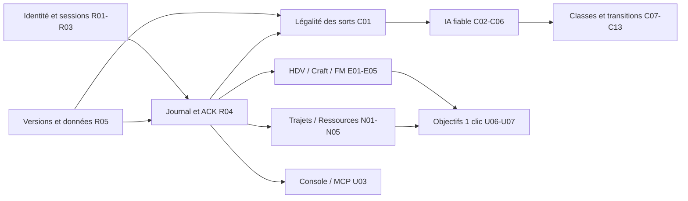

# GivreWork — plan directeur d'amélioration, migration et rationalisation

**Date :** 13 novembre 2026. **Nature :** proposition technique et produit, à exécuter par incréments. **Source cible :** `%USERPROFILE%/.t3/worktrees/GivreWork/fix-f01-f16-final-20261024` (HEAD constaté `b4d28a8`). **État local :** 496 lignes `git status --short` observées pendant cet inventaire : conserver le travail existant, ne pas réinitialiser ni nettoyer les worktrees. Les statuts historiques ne valent pas certification actuelle.

## 0. Vision, contraintes, décisions

Construire une application Windows de pilotage Dofus 3.7+ **modulaire et stable**, utilisable comme **joueur assisté**, **semi-bot** ou **bot autonome configurable**. Garder une UI **desktop classique et dense** : tableaux, onglets, panneaux fractionnés, barres de statut, diagnostics consultables. Les modules existants restent activables/désactivables séparément. Tout objectif a un début, une fin mesurable, un budget/limite, un état de progression et un Stop réel. L'IA en production fonctionne localement, sans dépendre d'un LLM.

Principes d'exécution : une session appartient à un seul personnage/compte/serveur et génération de connexion ; une action distingue `proposée / envoyée / acceptée / confirmée / refusée / issue inconnue` ; une action dont le résultat reste inconnu n'est pas répétée aveuglément ; un test offline ne certifie jamais la réussite serveur ; la compatibilité entre client, protocole, données et mods est **versionnée séparément**.

Le plan préserve les identifiants des **161 lots** déjà suivis par le programme (`/skills/givre-program/references/board.json` et catalogue `docs/codex/agent-program-20261026`). Les ID ci-dessous désignent des livrables de roadmap et doivent être reliés aux lots existants avant attribution ; aucune migration silencieuse du board.

## 1. Sources et stratégie de réutilisation

### A. Sources propres à réutiliser

- `%USERPROFILE%/Downloads/givre-GivreActive/Videos/GIVRE/GivreActive` : copie locale trouvée ; ancien dossier `%USERPROFILE%/Videos/GIVRE/GivreActive` absent lors du contrôle. Code VB.NET, stratégies, métriques, outils, datasets. L'étude existante `docs/codex/GIVRE_ACTIVE_STUDY_20261102.md` a identifié huit opportunités concrètes. Le code est réutilisable sous l'autorisation de son propriétaire, mais les mappings et offsets sont à vérifier pour le client actuel.
- `%USERPROFILE%/Downloads/GivreClone` : source C#/outils à inventorier et comparer par hash/fonction, sans réimporter des modules déjà présents.
- `%USERPROFILE%/Downloads/givrework` et les autres worktrees sous `%USERPROFILE%/.t3/worktrees/GivreWork` : rechercher les correctifs achevés mais non intégrés à partir de la provenance Git et des tests, en préservant leurs modifications. Ne pas considérer un dossier plus récent comme un état plus fiable sans preuve.
- `%USERPROFILE%/Videos/GIVRE/GivreWork*`, `GivreLauncher`, `GivreProxy` : sources historiques de comparaison uniquement tant que l'architecture, les identités de processus et la version des fichiers ne sont pas réconciliées.
- `%USERPROFILE%/Downloads/MizanBot-Setup-1.3.4` : installation/binaire, **pas preuve d'accès au code source**. Réutiliser des idées publiques ; pour du code source Mizan, passer par un checkout autorisé et vérifier la licence.
- `%USERPROFILE%/Downloads/givre-DofusReverseIndexer/Videos/GIVRE/DofusReverseIndexer` et `%USERPROFILE%/Downloads/givre-DungeonMapFinder(1)/Videos/GIVRE/DungeonMapFinder` : outils de diagnostic/indexation et recherches de cartes à comparer au pipeline data, aux graphes et aux outils existants avant tout import.
- `%USERPROFILE%/Downloads/dofus-aggro-overlay` : géométrie de zones dangereuses, pathfinder et simulateur TS ; ses rayons 1/2/3 cases sont des **hypothèses du README**, pas des règles de chaque monstre du client. Valeur : visualisation « risque estimé », aucune garantie d'éviter toute agression. Licence de réutilisation à confirmer.
- `%USERPROFILE%/Downloads/dofus-harvest-overlay` : classificateur, interactifs, suivi d'épuisement, aperçu des repops, démonstrateur TS ; son `package.json` déclare MIT, mais les durées du README restent empiriques et ne doivent pas devenir une preuve d'un repop serveur. Adapter l'idée au MapViewer Avalonia, pas au moteur Touch/Electron exposant `isoEngine`.
- `%USERPROFILE%/Downloads/BetterDofus-2.13.1` : seul un texte d'information `LISEZ-MOI.txt` a été trouvé, **aucun code à porter** dans cette copie.

### B. Projets et études externes

| Projet | Bonne idée à transposer | Précaution |
|---|---|---|
| [BillBot](https://github.com/Valentin-alix/BillBot) | Replanification après confirmation, route/cartographie, tâches et sessions | Son IA de combat observée est gloutonne ; conserver notre recherche bornée et les acteurs contrôlés |
| [D3B](https://github.com/AerafalDev/D3B) | Sorts par grade, recherche de séquences PA/PM, simulation d'états, mécanique de masques et scoring des menaces | Licence MIT à respecter ; règles et données à revalider sur client installé |
| [BubbleBot / Bubble.D3.Bot](https://github.com/AlpaGit/Bubble.D3.Bot) | Effets par sort, contraintes de ciblage et simulation sur clones d'acteurs | Plusieurs adaptateurs de portails/marques sont incomplets ; ne pas annoncer classes complètes |
| [JondoEmu](https://github.com/Keka-Bron/JondoEmu) | Modélisation Xelor, portails, marques, historique de cases et tests d'effets | L'émulateur n'est pas un oracle du serveur officiel ; tests sur captures autorisées |
| [MoonBot](https://doc.moon-bot.io/) | API Lua documentée, parcours métiers/banque, templates de scripts et supervision | Fonctionnalités annoncées à confirmer ; la documentation publique affichée est aussi orientée Retro |
| [DoFarm](https://dofarm.io/) | Expédition, HDV, console unifiée, scripts, tableau de bord distant | Communication commerciale, non preuve d'implémentation ni de performance |
| [Asterobot](https://asterobot.net/) | Scénarios combinés récolte/combat/banque, planning et reconnexion | Revalider les capacités annoncées ; éviter de dupliquer nos modules existants |
| [Givre Script Creator](https://script.givre.eu/) | Graphe de blocs combat/trajets/récolte exporté en Lua | Préférer un éditeur visuel borné utilisant notre DSL commun plutôt qu'une seconde exécution concurrente |

Références internes détaillées : `docs/codex/BILLBOT_STUDY_20261102.md`, `BUBBLE_STUDY_20261102.md`, `PENOMBRE_D3B_STUDY_20261102.md`, `CLASS_TRANSITIONS_20261102.md`, `GIVRE_ACTIVE_STUDY_20261102.md`, `docs/COMPETITOR_GAPS_20261020.md`.

### C. Ports prioritaires depuis GivreActive (à intégrer, pas recopier en bloc)

| ID | Composant historique et emplacement | Port dans GivreWork / valeur concrète | Gate avant intégration |
|---|---|---|---|
| A01 | `EasyBot/PacketAnalyser/Function/Combat/CombatUncertainCastGate.vb` | **Comparer les contrats, sans copier le module** : GivreWork possède déjà une protection d'issue incertaine (`LaunchService.Combat.Script.cs`, `MZP0RecoveryJournal`). Unifier uniquement les cas non couverts | Casting refus/timeout/ACK tardif ; aucune seconde injection |
| A02 | `EasyBot/WorldPathfinding/{WorldGraph,WorldPathFinder}.vb` | Reprendre génération de trajet, transition interactive verrouillée jusqu'à snapshot d'arrivée et secteur exact ; intégrer à `MapTransition`/routage courant | Fixture porte multi-secteurs, carte réelle de destination ; aucun ancien mapping dans le port |
| A03 | `EasyBot/.../CommunityToolkit.vb` et `AllfunctionsLua.vb` | Quarantaine temporaire de ressource par carte/élément/skill, sélection par coût de chemin plutôt que distance naïve | Échecs successifs, changement de carte, reprise, arrêt : aucun comptage sans reçu |
| A04 | `EasyBot/CommerceIntelligence/DocraftSellPolicy.vb` | Préflight taxe de **l'ordre suivant** contre budget global et prix indépendant, dans `HdvViewModel.*`/politique HDV | Montant taxé exact et cumul reçu ; mode strict activable ; échec sans achat/vente |
| A05 | `EasyBot/CommerceIntelligence/DocraftRecipePlanner.vb` | Raccorder l'API Lua craft à **l'actuel** `ItemCraftPlanner` qui sait gérer rendement et surplus ; retirer le calcul simplifié redondant `LotM/CraftPlanner` seulement une fois tous les appels migrés | Recette multi-niveaux, partage d'intermédiaires, stock observé et résultat serveur |
| A06 | `EasyBot/ForgeIntelligence/{ExoFastForgePlanner,ExoFastQueuePlanner,ExoFastRunePackPlanner}.vb` | Politique unique de classement des lignes, files PA/PM avec ACK et budget d'achat de runes dans ForgeEngine/SmithMagic | UID de l'objet et résultat de rune confirmés ; stock inconnu => stop ; pas de probabilité inventée |
| A07 | `EasyBot/PacketAnalyser/Function/Combat/{CombatTelemetryFeed,CombatTraceRecorder}.vb` | Événements typés bornés, délais monotones dispatch→ACK, graphiques/console de combat et replays | 0 fuite d'authentification ; budget mémoire borné ; ordre strict par session |
| A08 | `tools/givre-test-mcp-server/src/{ab,stats,metrics}.ts` et scripts PowerShell de mesure | Banc hors jeu AB/BA, comparaison p50/p95, tours vides, réussite défis, rendement et stabilité | Exécuter uniquement sur fixtures/sessions de test contrôlées ; version+hash, répétitions et variabilité visibles |
| A09 | `EasyBot/PacketAnalyser/Function/MOVE/ScriptLUA/PluginsScript/treasure.vb` | Conserver provenance/horodatage/conflict entre sources d'indices de chasse | Aucun endpoint ancien présumé valide ; conflit explicite et arrêt sûr |
| A10 | `EasyBot/Packets/Data/D2O/SqliteGameData.vb` et `DataSets/3.7.7.6/` | Réutiliser méthodes de provenance, contrats de tables et outils d'inspection read-only | Ne jamais promouvoir un dataset 3.7.7.6 au rang de dataset 3.7.12/13 sans validation |
| A11 | `tools/JondoCompat/Combat/ShadowDecisionComparer.cs` | **Port candidat à forte valeur :** comparer hors jeu deux planificateurs sur un même état sans jamais exécuter les actions du « shadow » ; alimenter `CombatJournal` | Même snapshot/grade/budget, décisions divergentes explicitées, zéro commande exécutée par le comparateur |
| A12 | `EasyBot/Diagnostics/SessionDiagnosticBundle.vb` | **Port candidat :** bundle ZIP expurgé pour analyse de bug (version, transitions, dernier ordre, ACK et mapping) | Aucun token, email, nom privé, session secrète ; preuve d'absence de données sensibles dans export |
| A13 | `tools/*/MapViewerSnapshotFreshnessTests.ps1` | **Port candidat :** régressions de génération/fraîcheur du MapViewer et des cartes, rejeter snapshot périmé | Aucun ancien snapshot ne remplace une carte plus récente après changement de session |
| A14 | `EasyBot/PacketAnalyser/Function/MOVE/ScriptLUA/ReadScript.vb:108-149,212-305` | **Port ciblé :** pause/reprise coopérative et purge des callbacks d'une ancienne exécution dans le `GivreLuaHost` actuel | Pause ≠ Stop ; Stop gagne toute course ; aucun callback du run précédent après reprise ; tests cancellation et relogin |
| A15 | `EasyBot/CommerceIntelligence/DocraftBuyPolicy.vb` et `DocraftSellPolicy.vb` | **Adapter seulement les politiques pures** : lots admissibles, ordre déterministe, réserve de kamas et préflight de budget taxe multi-lots ; `HdvTradeLogic`, `HdvSalePriceGuard` et `MarketDeals` existent déjà | Achat/vente refusé si prix, lot ou UID ne correspond pas ; prévisualisation sans ordre |
| A16 | `EasyBot/.../QuestCriterionEvaluator.vb:6-92` | **Port de diagnostic** : distinguer critère vrai, faux et inconnu dans `GivreClone.Protocol/QuestCriteria.cs`, sans transformer « inconnu » en vrai | Quête/carte bloquée par critère inconnu, motif visible et test de la grammaire |
| A17 | `scripts/Product/GivreLeveling50/BankRecovery.lua` et `tools/Test-BankInventoryDailyUse.ps1` | **Reprendre les scénarios de test et listes de protection**. `LaunchService.Bank.cs:315-400` possède déjà reçus UID/quantité ; le script historique requiert un adaptateur non livré et n'est pas appelé par `Main.lua` | UID faux, partiel, retard, changement de coffre/connexion, timeout et objet protégé ; aucun faux succès |
| A18 | `scripts/Product/GivreLeveling50/{Main.lua,ClartekRouteBackend.lua,PiouMarket.lua}` | **Port ultérieur de scénarios/fixtures** de progression Clartek 1→50 dans Lua/route/HDV actuels, sans les importer comme auto-run prêts | Maps, PNJ, GID, prérequis, trajet, prix et observations requalifiés pour le client actuel ; arrêt sur divergence |
| A19 | `DofusUnityMapping/{ProtocolMessageCompatibility,ProtocolBinaryCompatibility}.cs` | **Réutiliser les comparateurs sémantiques de schémas en lecture seule** dans la vérification `MZP10/MZP11/MZP12` | Aucune migration d'alias/opcode d'un ancien build dans le transport live, comparaison versionnée reproductible |

**Choix :** conserver notre architecture C#/Avalonia, nos définitions protocole récentes, nos ACK et nos fonctionnalités déjà plus avancées ; **ne pas importer** l'ancien GUI WinForms, un second contrôleur de combat, des identifiants réseau hérités, des délais codés en dur ou une autre pile de capture.

## 2. Corrections bloquantes — fiabilité du socle

Les trois corrections hors jeu déjà apportées le 13 novembre sont : compilation `PureTests`, seuils `Pa/Ra=0`, décodage de trames coalescées ; preuve dans `AUDIT_AGENTS_20261113.md` (362 tests autonomes). Elles doivent rejoindre les vérifications de release et ne constituent pas une validation gameplay.

| ID / priorité | Correction | Emplacement principal | Critère de clôture |
|---|---|---|---|
| R00 / P0 | **Bloquer l'injection gameplay avec mapping « même famille » mais build différent**. Séparer `ExactBuild`, `CompatibilityReviewed` et `DiagnosticOnly` ; jamais confondre la famille 3.7 et l'empreinte exacte du protocole | `MZP10MappingVersionAdmission.cs:40-68`, `MappingCatalog.cs:145-160`, `MZP12SocketVersionBinding.cs:77-80`, `Transport/Socket/SocketGameClient.cs:327-345` | Build différent => lecture diagnostique seulement ; test positif même build+hash et test négatif cross-patch avec zéro envoi |
| R01 / P0 | Un seul comportement actif par session. Arrêter/attendre l'ancien, annuler toutes les actions, invalider génération | `GivreClone.Engine/Behavior.cs:23-46`, runtime supervisé | 100 transitions Start/Stop/Restart sans commandes de l'ancien comportement |
| R02 / P0 | Reconnect : une identité immuable session+génération, éviction des connexions anciennes, aucun PID réutilisé comme vérité | `GivreClone.Engine/SessionBinder.cs:14-89`, compte/transport | Reconnexion même PID puis autre personnage : zéro action au mauvais acteur |
| R03 / P0 | Publication événementielle FIFO par session et états transactionnels `UNKNOWN` persistés | `MZP1GuardedEngineWiring.cs:98-148`, bus, journal | Fixtures de concurrence et réponse tardive ne produisant ni ordre inversé ni double achat |
| R04 / P0 | Contrat homogène d'ACK et d'arrêt pour banque, inventaire, HDV, craft, forge, déplacement, combat. **La banque possède déjà des reçus UID/quantité**, les renforcer par régression plutôt que reconstruire son mécanisme | `LaunchService.Bank.cs:315-400`, `LaunchService.Hdv.cs`, `LaunchService.Forge.cs`, actions MCP | Aucun `success=true` sur la seule injection ; confirmation correspond à UID/GID/quantité/prix/action |
| R05 / P0 | Figer compatibilité à la version réellement observée, avec provenance du client, champs, bundles et module natif | `Services/ProtocolUpdates`, `server-mapping`, `GameDataUpdates`, native | Version inconnue => fonctionnalités incompatibles indisponibles et motif visible |
| R06 / P1 | Enchaînement des casts : conserver la confirmation de modificateur tardive | `LaunchService.Combat.SpellMods.cs:38-82` | Modificateur reçu en retard appliqué au bon sort / pas à un tour suivant |
| R07 / P1 | Rotation mixte : aucun sort offensif éligible ignoré à cause du planner | `Combat/AutoSpellRotation.cs:30-53`, `LaunchService.Combat.Turn.cs` | Deux ordres des sorts + 6 PA/2+4, autorisations et refus correctement gérés |
| R08 / P1 | Défis manuels idempotents, ID/bonus comparés, état choisi stable | `BotRowViewModel.Fight.cs`, `LaunchService.Combat.PreFight.cs` | Après choix confirmé, aucune re-proposition ni second envoi |
| R09 / P1 | Journal système GUI/MCP unifié, chat refusé avec motif et commandes MCP `zaapi_to` suivies | `BotsViewModel.{GameJournal,Console,McpJournal}.cs`, `Services/Mcp/McpConsole.cs` | Attente MCP reçoit défi/victoire/fin d'action et résultat refusé de chat |
| R10 / P1 | Clés comptes/serveurs/IDs pour profils et planning, migration des anciennes clés basées sur le nom | `CombatProfileStore.cs`, `PlanningStore.cs` | Deux homonymes sur serveurs différents conservent des paramètres indépendants |
| R11 / P1 | Corriger les tests flaky *réellement* instables ; isoler les dépendances locales/externes des tests CI, sans supprimer leur couverture | `GivreClone.PureTests`, `GivreClone.Tests`, docs/validation | Build reproductible depuis clone propre, tests purs sans jeu ni GivreCore propriétaire |
| R12 / P2 | Expiration/cap mémoire/cache des sessions et attente de réception, diagnostics de fuite | `SessionBinder`, caches de métadonnées, logs | Session clôturée devient inaccessible ; métrique mémoire stable sur 1000 cycles |
| R13 / P1 | Position **confirmée vs prédite** : la barrière Lua ne doit pas se débloquer sur une destination envoyée sans écho serveur ; timeout signalé aux appelants | `BotWorldStore.cs:94,242-250`, `GivreLuaHost.cs:743-756` | Prédiction de déplacement ne satisfait pas `WaitSelfReady`, écho/refus/teleport et reprise testés |
| R14 / P1 | Décodeur Socket incrémental borné : ne pas garder une frame infinie ni allouer sur un préfixe varint non validé | `Transport/Socket/SocketGameClient.cs:827-855,1760-1777` | Messages fragmentés/coalescés conservés ; trames surdimensionnées et varint invalides refusés sans croissance mémoire |
| R15 / P2 | Encapsuler numéro de champ/codec d'enveloppe dans un contexte de session immuable plutôt qu'une variable statique globale | `GivreClone.Protocol/EnvelopeBuilder.cs:27-36`, `Transport/Socket/SocketGameClient.cs:310` | Deux catalogues simulés n'intervertissent jamais leurs schémas |
| R16 / P0 | **Empêcher la perte de données utilisateur à la lecture d'un JSON corrompu**, restaurer le dernier backup sans écraser l'original puis migration atomique des sauvegardes comptes/proxy/prix/FM | `Services/Eco/EcoStores.cs:57-69`, `AccountManager`, `ProxyStore`, `AtomicJson` | Corruption préservée et signalée ; relecture/restauration explicite ; sauvegarde concurrente sans perte |
| R17 / P0 | **Corriger la restauration des paramètres d'expédition** : `ContinueAfterDeath` et `MaxConsecutiveDefeats` sont sauvegardés mais restaurés avec des valeurs différentes | `BotsViewModel.Expedition.cs:613-619,647-659` | Roundtrip false/true et limite 0/3 réels ; anciennes sauvegardes migrées sans valeurs inventées |
| R18 / P1 | Indexer statistiques HDV par identité stable et conserver l'âge/provenance du prix ; corriger les libellés « kamas/h » calculés sur solde sans transactions | `HdvStatsStore.cs:27-57`, `ExpeditionScript.cs:387-401` | Deux homonymes indépendants, résultat net fondé sur reçus, solde non présenté comme profit |
| R19 / P1 | Ne pas recommander automatiquement un brisage à partir de prix artificiels (formules fixes sans devis) ; rendre explicitement « inconnu » en l'absence de source | `SmithMagic/CrushingArbitrageEngine.cs:45-56` | Prix absent => pas de recommandation d'achat/brisage, preuve du prix+date+serveur quand connu |

## 3. Combat — IA complète par données réelles

**Existant à conserver :** `CombatTurnPlanner` (recherche bornée PA/PM, marche/cast/marche, téléport simple), grades appris, contrôle des compagnons, dégâts/effets immédiats, soin/bouclier élémentaires, modes distance/CAC, challenges, journal. Des mécaniques complexes ne sont pas intégrées malgré la présence de classes/sorts dans les données. La version du modèle doit être affichée dans chaque profil.

| ID / priorité | Fonction | Dépendances et condition de preuve |
|---|---|---|
| C00 / P0 | **Corriger la classification des marques** : `Type == 4` ne suffit pas à identifier un portail (runes Huppermage également observées) | `LaunchService.Combat.cs:253-275` + `CombatForcedMovesReplayTests.cs:184`; tests Huppermage 2 runes => 0 portail, Élio 2 portails => 2, ownership/état actif vérifiés |
| C01 / P0 | **LegalCast unique** : grade, PA/PM, portée réelle, LoS, cellules, masques, états, limite par cible/tour, cooldown, propriétaire d'un sort | Décodeur de données installées + état serveur ; même validateur pour choix et dispatch ; état inconnu => pas de cast autonome |
| C02 / P1 | Boucle **observer → planifier → agir → confirmer → recalculer** après chaque action | R01/R03/R06/R07 ; scénario même tour et retarget après mort |
| C03 / P1 | Scoring dégâts réels : résistances cible, boucliers, criticité, overkill, dégâts zone, alliés affectés, danger du tour suivant | Données FighterStats/SpellDescriptor ; 100 replays predicted-vs-observed, inconnus conservateurs |
| C04 / P1 | Optimiser PA et PM ensemble : casts, marche, téléport, retrait/kite final, réserves de PA, tacle/fuite | C01–C03 ; plan identique dans mêmes snapshots et jamais de tour vide avec cast légal disponible |
| C05 / P1 | Soins/boucliers/boosts/debuffs utiles selon urgence, réduction de menace et durée | Effets non offensifs par grade, préconditions ; pas de soin sur cible invalide |
| C06 / P1 | Challenge-aware planning : zones, interdit/obligatoire, fin de tour, état challenge et compromis XP/drop | Journal challenge par acteur ; aucun défi marqué réussi avant résultat serveur |
| C07 / P1 | Multi-acteurs / équipes : leader, focus, invocation/compagnon, ordre de contrôle, formation et tour coordonné | États propres par acteur ; commandes limitées au propriétaire, aucun héritage de stats |
| C08 / P2 | Trajectoires forcées : attraction, poussée, échange, téléport et collision | Vérifier états porté/ancré/invisible, projection board + ACK ; `ForcedMovementSafe=false` jusqu'à preuve |
| C09 / P2 | Classes à états : Zobal masques, Sacrieur effets/états, Huppermage combinaisons, Ouginak, Steamer | Modèle générique add/remove/durée/hook, puis packs par classe, grade réel |
| C10 / P2 | Sram : invisibilité, pièges, marque et déclenchement ; Roublard : bombes, murs, combo, explosion | Historique owner/marks/triggers et évènements observés ; pas de support annoncé avant replay complet |
| C11 / P2 | Xelor : cellules précédentes et Telefrag ; Eliotrope : réseaux de portails et projection de sort | Observations d'historique et d'activation ; tests de transitions, replays indépendants |
| C12 / P2 | Positionnement initial anticipant menaces, zones, équipes et objectifs challenges | C03/C04 ; fixtures mêlée/distance et cases occupées |
| C13 / P2 | Planificateur de sorts à distance/portails/zones qui préserve l'incertitude et les immunités | Conserver les effets multiples, masque par effet, alternative en cas de critère inconnu |
| C14 / P2 | Télémétrie et visualisation : action prévue, cellule, AP/MP avant-après, score/résultat, motif de refus | A07 ; HUD compact et replay offline ; aucune injection requise pour afficher les faits |
| C15 / P3 | Évaluation adaptative des poids sur corpus de combats confirmés, presets par classe/activité | Data A/B avec garde anti-surapprentissage ; jamais choisir des actions illégales pour « apprendre » |

Performance à mesurer avant modification : `CombatTurnPlanner.cs:285-318` dépense du budget dans ReplyMap, `:565-640` recalcule des portails et `:1290-1297` peut refaire le classement ; `MapPathfinder.cs:151-162,224-229` multiplie les A*. Banc Release via `CombatPlannerPerformanceTests.cs` et `docs/cos-dofus-video/rapports-v2/N03/bench/Program.cs`, 1/3/8 ennemis, budgets 5k/30k/60k, p50/p95/p99, allocations, choix de sort identique avant/après. Optimiser seulement après résultat mesuré.

## 4. Déplacements, récolte, expéditions, donjons

| ID | Fonction/reprise | Critère d'acceptation |
|---|---|---|
| N01 | Unifier la planification **carte locale → portes/zaaps/zaapis → carte destination** avec origine secteur/cellule et recalc sur refus | 0 boucle de transition ; carte serveur + snapshot complémentaire confirmés |
| N02 | Éditeur de trajet classique : carte cliquable, waypoints, interactifs, conditions, banque, retour et aperçu des étapes | Export/import validés ; arrêt/remplacement pendant action ; chemins enregistrés persistants |
| N03 | Récolte intelligente par coût réel, compétence, accessibilité, fraîcheur et quarantaine A03 | Ressource inaccessible non relancée en boucle ; retour après fenêtre bornée |
| N04 | Objectif en quantité : depuis bestiaire/recette/ressource/monstre → stock observé, reste, planning et Stop | Ne jamais dépasser un objectif à cause des stocks déjà possédés ; succès confirmé |
| N05 | Récolte + aggro + combat + reprise exact même objectif, gestion morts/pods et état inconnu | Abandon/timeout propre, aucun faux compteur de récolte |
| N06 | Donjon : navigation salles/conditions/clefs/retour, sorties et interruption en plein donjon | Périmètre borné par donjon, preuve d'ouverture/transition et de fin |
| N07 | Expédition : monstres requis/interdits, niveau min/max, zones interdites, budget combats, XP/drop par heure, arrêt après N défaites | Paramètres respectés, résultat journalisé et reprise depuis point sûr |
| N08 | Chasse au trésor : indices, fournisseur et date, ambiguïtés visibles, carte/marque, coffre, combat, récompense | Chasse complète testée ; aucune étape devinée sans observation |
| N09 | Quêtes et progression : tracker de jalons déjà codé → runtime et assistant par étape/conditions | Statut et récompense confirmés ; arrêt explicite quand interaction manuelle requise |
| N10 | Collecte d'âmes/archimonstres : état inventaire pierre, monstres recherchés, rapport Metamob optionnel | Ne pas déclarer capturé avant reçu serveur ; arrêt sur pierre manquante |
| N11 | Expédition multi-sous-zones persistantes, avec filtres/état sérialisés par identité | `BotsViewModel.Expedition.cs:481-502,613-659` ne sérialise actuellement qu'une sous-zone ; test A+B → sauver/recharger → A+B |
| N12 | Couche MapViewer **zones d'agression estimées** (optionnelle), chemin de contournement avec observation des groupes réels | Tests sur carte à obstacles, mob qui bouge et inconnus ; aucune zone supposée absolument sûre |
| N13 | Couche MapViewer **ressources actives/épuisées**, filtre par métier et repop estimé avec horodatage et marge d'erreur | Le serveur fait foi sur l'état actif ; temps de repop annoté estimation, aucun clic si skill désactivé |

## 5. HDV, économie, métiers, craft, FM/EXO

**Déjà présents :** scan marché, prix historiques/alertes, achat/vente, repricing, forge, rune advisor, craft planner multi-niveaux, stocks unifiés, métiers, tableaux de suivi. Les ajouts ci-dessous doivent **raccorder** des chaînes déjà existantes plutôt que créer de nouveaux moteurs.

| ID | Fonction | Critère d'acceptation |
|---|---|---|
| E01 / P0 | Transactions HDV/banque/craft/FM avec preuve UID/quantité/prix/taxe, état Unknown bloquant répétitions | Refus et ACK tardif testés, pas de double ordre |
| E02 / P1 | Tableau de rentabilité réelle : frais, net, prix d'achat daté/serveur, prix proposé vs vendu, inconnus | Aucun prix obsolète présenté comme « marché actuel » ; calcul réconciliable |
| E03 / P1 | Recette → manquants → acheter/récolter → atelier → fabriquer → stockage/vente, tout en un objectif | Confirmation à chaque transition et Stop ; budget achat plafond et réserve |
| E04 / P1 | Cibles FM par objet, budget global runes/taxes, stop sur échec/stock/puits inconnu, queue PA/PM opt-in | UID support immuable, rune appliquée confirmée, budget non dépassé |
| E05 / P1 | Préflight HDV A04 + prix indépendant + tolérance d'écart réglable ; statistiques de remise en vente | Aucun ordre si seuil dépassé, prix de référence absent en mode strict |
| E06 / P2 | Conseiller « craft ou achat ? » par rendement, surplus, stocks disponibles et fraîcheur des devis | Comparaison de coût reproductible, inconnus signalés |
| E07 / P2 | Professions : XP métier, efficacité recette, trajet à ateliers vérifiés, répartition ingrédients par comptes autorisés | Traçabilité de la provenance des recettes et version des bundles |
| E08 / P2 | Journal des tentatives FM et estimateur de budget (observations, pas prédiction magique de succès) | Export, différences avant/après, collecte de coûts exacts |
| E09 / P2 | Batch vente/réapprovisionnement : plan previewable, quantité maximale, budget, annulation entre lots | Aucune transaction déclenchée par un aperçu ; receipts attribuables |
| E10 / P1 | Comptabilité nette **réalisée** par objectif : stock initial, achats, taxe, coût de revient, ventes confirmées, transferts | Un transfert de kamas entre comptes ne crée aucun bénéfice ; revenu sans coût documenté reste `UNKNOWN` |
| E11 / P1 | Historique de prix : requêtes concurrentes corrélées au bon GID et à la session avant calcul d'opportunité | Deux GID interrogés en parallèle ne partagent jamais des séries, sinon résultat `UNKNOWN` |
| E12 / P2 | Liquidité, lots immobilisés, stock vendable et stock réservé ; preuve de retrait/vente de chaque annonce | Prix d'annonce ≠ vente ; lot âgé mais invendu n'entre pas au bénéfice réalisé |

## 6. Interface classique, autonomie et scripts

### Structure d'écran cible

```text
┌──────────────────┬──────────────────────────────┬────────────────────────────┐
│ Comptes / bots   │ Carte / activité / combat     │ Inspecteur / paramètres    │
│ Rechercher       │ Carte 560 cases / trajet      │ Cible, métier, sort, FM    │
│ Filtrer, trier   │ Timeline des actions/ACK      │ Limites et provenance      │
│ Pseudo / état    │ Tableau dense des cibles      │ Détails sélectionnés       │
├──────────────────┴──────────────────────────────┴────────────────────────────┤
│ Console filtrée par bot — serveur, défi, transport, Lua, erreur             │
├────────────────────────────────────────────────────────────────────────────┤
│ Session • version • action • reçu • pods • objectif restant • Start/Stop   │
└────────────────────────────────────────────────────────────────────────────┘
```

Fonctions de la barre latérale : **Bots**, **Combat**, **Carte & trajets**, **Expédition & récolte**, **Métiers & craft**, **HDV & FM**, **Quêtes & chasses**, **Scripts & planning**, **Diagnostics**. Les fonctions avancées apparaissent comme sous-onglets, pas comme fenêtres flottantes sans contexte.

| ID | Ajout / correction | Gate |
|---|---|---|
| U01 / P1 | Assistant nouvelle session : client+mode compatible, personnage/serveur, test droits, choix objectif et profil | Aucune action si profil non lié à l'identité courante |
| U02 / P1 | Catalogue des modules avec interrupteurs indépendants, état `disponible / incompatible / expérimental`, raison et dépendances | Off = plus d'effet ni hook actif ; mode MITM/Socket compris |
| U03 / P1 | Console unique à événements structurés, filtres par session/acteur/gravité/action, copie/export expurgés | Même événement et statut côté GUI et MCP, déduplication |
| U04 / P1 | Défis/challenges en ligne : proposition, sélection, ACK, bonus XP/drop, condition, résultat | État stable sur refresh, aucune double sélection |
| U05 / P1 | Boutons d'action contextuelle : personnage MP/échange/copier, monstre combat ciblé, NPC parler, ressource utiliser | L'action correspond à l'identité et cellule sélectionnées ; disparue => refus |
| U06 / P1 | Assistant sans code **réellement exécutable** : blocs trajet, combat, métier, FM, banque, HDV et Stop ; exporter Lua si voulu | Simulation preview, validation, exécution locale et annulation d'un objectif borné |
| U07 / P1 | Tableau des objectifs et alarmes : quantité, pods, durée, kamas, défaites, déconnexion et dernier ACK | Événements et preuves visibles ; seuil atteints arrêtent le bon module |
| U08 / P1 | Unifier choix de profils et planning par compte/serveur/ID ; recherche, duppliquer, comparer, migrer | Homonymes indépendants et aucune perte sur migration |
| U09 / P2 | Éditeur Lua avec API réellement branchée, complétion, lint, test offline, journal à la ligne, catalogues signés | APIs « indisponibles » explicites ; aucune fonction stub annoncée opérationnelle |
| U10 / P2 | Monitoring local optionnel et panel distant **à lecture seule au départ**, rôles, jetons courts, aucun secret | Contrôles d'accès et journal d'audit ; commande distante séparée par permission |
| U11 / P2 | Diagnostiqueur « Pourquoi il ne fait rien ? » : données absentes, attente ACK, budget épuisé, tour non actif, profil désactivé | Chaque état bloqué affiche cause, session et dernière transition |
| U12 / P2 | Simulation de combat et de trajet explicable (règles candidates, score et contraintes), export de replay | Le replay n'envoie aucun ordre réseau ; configuration et version stockées |
| U13 / P2 | Équipement : comparer les objets réellement présents, proposer un set/bonus et appliquer seulement des remplacements autorisés, UID confirmés | Prévisualisation des gains exacts, limites par classe/niveau, aucun équipement changé silencieusement |
| U14 / P2 | Gestion approfondie des métiers/montures : reprendre l'existant Breeding uniquement après inventaire des états et actions effectivement câblées | Statut `lecture seule` tant que non confirmé ; pas de module « élevage auto » annoncé sans reçus |

**Refonte UX en conservant les acquis :** `MainWindow.axaml` et `ClassicShellBody.axaml` utilisent déjà les mêmes ViewModels, Ctrl+K/quick navigation et un mode de densité. Il ne faut pas reconstruire un troisième shell. Réorganiser les **17 onglets de `BotsView.axaml`** dans cinq familles fonctionnelles via `QuickNavigationCatalog.cs`, tout en préservant les tags et le retour `Alt+←`. Remplacer progressivement la carte par compte et ses 752 px d'actions défilantes (`AccountsView.axaml:206-210,371-492`) par une table virtualisée + inspecteur. Tester 960×600 et 1460×920, 50 comptes/20 sessions/10 000 événements synthétiques, accessibilité Tab/Échap, FR/EN/ES et arrêt toujours visible.

## 7. Modules à fusionner, masquer ou retirer

**Ne rien supprimer immédiatement.** Chaque suppression a un inventaire des appels, une migration éventuelle, un test de non-régression et un plan de retour. Aucun des éléments ci-dessous ne doit être effacé uniquement sur son nom.

1. **Fusionner** les planificateurs de recette : les chemins `LotM/CraftPlanner` et `ItemCraftPlanner` doivent partager la même représentation des rendements, surplus et stocks. Adapter Lua à l'implémentation récente, puis retirer la logique obsolète si tous les appelants passent.
2. **Réduire le nombre de sources d'état** : un seul modèle canonique de session, journal, statut d'ordre et identifiant de personnage ; les multiples vues GUI/MCP deviennent des projections.
3. **Unifier les décisions de combat** : un seul validateur de légalité et un seul point de dispatch ; fallback classique conservé uniquement comme mode réellement demandé/explicitement nécessaire et testé.
4. **Consolider l'assistance sans code** : `NoCode`, `NoCodeLot2`, assistants métier et éditeurs de trajet deviennent des générateurs d'un DSL partagé plutôt que des exécuteurs parallèles.
5. **Éliminer les succès simulés** : remplacer tous les booléens `true` après simple `Send`/delay par un résultat structuré. Les messages diagnostiques restent conservés.
6. **Masquer** les fonctionnalités dont la compatibilité est inconnue : overlay tactique natif, actions de monture/marchand encore stub, transitions non observées, anciens binaires épinglés à d'autres versions. Afficher le motif et fournir une vérification ciblée.
7. **Déprécier** les routes qui utilisent un nom de personnage comme clé unique, les heuristiques « prix 1 kama » en mode de vente strict, les données clients sans version et les pauses fixes pour conclure une action.
8. **Classer en archives** les dossiers de build/capture dupliqués après manifeste de provenance et preuve qu'aucun module ne les référence. Ne pas nettoyer les autres worktrees ni les dépôts sources.
9. **Candidats à supprimer après preuve :** `GivreClone.Protocol/GameCodec.cs` et le protobuf 3.6 associé s'ils ne servent plus qu'aux tests ignorés ; branche `Engine/MitmRelogin` in-process dont `UseInProcess` renvoie toujours false. Inventorier tous les appelants et réaliser la compilation propre avant retrait ; garder le relaunch utilisé et le journal de récupération.
10. **Ne pas fusionner** l'engine headless de replay avec l'état de la fenêtre Avalonia : ils ont des contrats de provenance et de test différents. Mutualiser seulement les types purs et les adaptateurs prouvés.
11. **Ne pas recopier les doublons de GivreActive** : `ChallengeSelectionPolicy.vb` (probabilités déjà dans `ChallengeOutcomeStore/ChallengeCatalog`), `CombatUncertainCastGate.vb` (contrats de journal déjà présents), `DocraftRecipePlanner.vb` (ItemCraftPlanner plus complet), `NativeMapViewport.vb` (WPF non compatible Avalonia) et `PathValidationHelper.vb` (validateur PL-only plus étroit). Si un cas de test manque, reprendre **ce cas**, pas sa seconde implémentation.

## 8. Releases, lots, dépendances et estimation

| Release / cible indicative | Lots à livrer | Dépendances | Critère de passage |
|---|---|---|---|
| **V0 Stabilisation** (1–2 semaines de développement) | R00–R05, R11, R13–R14, R16–R17, C00, A01, transactions critiques E01, diagnostics minimum | État de référence, régression concurrente, run offline | Version compatible connue, reconnect/double-send impossible sur harnais, save/restore sans perte, suite verte |
| **V1 Combat fiable** (2–3 semaines) | R06–R07, C01–C06, A07, A11, C14, U04 | V0, descriptions de sorts par grade, captures | Tours utiles, ACK, refus, défis et 100 replays ciblés explicables |
| **V2 Workflow unique** (2–3 semaines) | N01–N05, E02–E05, U01–U03/U05/U07, A02–A06, A13–A14 | V0, données vérifiées, actions métier idempotentes | Objectif quantité → banque/craft/vente/Stop avec comptes/résultats exacts |
| **V3 Optimisation et UX** (2–3 semaines) | N06–N10, E06–E09, U06/U08/U09/U11, performance planner | V1/V2, replays + bench Release | Modules opérables sans Lua, graphes/bench A/B et UX testés |
| **V4 Classes avancées / équipes** (3–6 semaines) | C07–C13, C15, coordination multi-comptes, simulation, Clartek A18 une fois requalifié | C01–C05 + données transitions/états/marques contrôlées | Packs classe certifiés individuellement ; aucune classe annoncée complète sans preuve |
| **V5 Écosystème** (optionnel) | U10/U12, scripts partagés, reprise machine, notifications externes | V0–V3, modèle de droits, sécurité de stockage | Lecture distante sûre, audit, isolation, rollback et documentation publique |

Les périodes sont des **ordres de grandeur d'effort actif**, pas un délai de livraison promis. Prévoir 20–30 % de marge pour la variabilité client/protocole et la validation en jeu. Les chantiers de recherche et UX peuvent avancer en parallèle ; les modifications des fichiers runtime partagés ont un responsable unique. La feuille de suivi garde les 161 identifiants d'origine, un propriétaire, un niveau de preuve et un critère de sortie. Une vague de 2 développeurs + 1 reviewer sur lots disjoints est un bon rythme initial, davantage seulement si les dépendances ne créent pas de collisions.

### Graphe des dépendances critiques



## 9. Mesure de qualité et validation

| Domaine | Métrique principale | Objectif d'acceptation proposé |
|---|---|---|
| Transactions | Doubles ordres sur ACK tardif/refus/timeout | **0** dans tous les tests de concurrence et scénarios bornés |
| Sessions | Ordres au mauvais compte/personnage après relogin/reconnect | **0** sur 100 transitions simulées + essais applicatifs concernés |
| Combat | Tours avec PA inutilisés **alors qu'un sort légal utile existe** | **0** sur le corpus reproductible défini ; ne pas confondre PA réservés et erreur |
| Combat | Disponibilité et précision des replays, delta AP/PM/HP/positions/états | 100 fixtures de base + par classe, écarts visibles et classés |
| Temps de décision | p50/p95/p99 du planner, allocations, BudgetExhausted | Aucune régression >10 % non justifiée sur même fixture/config ; viser gain mesuré |
| Trajets | Boucles de refus et transitions vers mauvaise carte/secteur | **0** sur fixtures multi-secteurs, refus et reconnexion |
| Récolte/craft | Stock/débit/consommation après chaque résultat | 100 % des augmentations de compteur appuyées par une observation |
| UX | Démarrer/arrêter un objectif depuis l'interface | 1 action après config, Stop utilisable partout, état explicite |
| Diagnostique | Actions acceptées vs exécutées vs confirmées | Même statut et même cause côté GUI, MCP et export |
| Build | Projet depuis checkout propre | Build reproductible, tests purs sans binaires locaux non déclarés |

Niveaux de preuve conservés : **analyse**, **test pur**, **intégration compilée**, **scénario applicatif**, **validation en session**. Pour les actions observables, captures/replays expurgés et identité de la build sont enregistrés. Le test en jeu vérifie les refus autant que les succès et ne confond pas effet graphique avec confirmation serveur.

## 10. Première vague à lancer

**W1 / six livrables bornés :**

1. **W1-A** — Réconcilier les changements locaux, relier au board les 3 fixes déjà appliqués, reproduire `R00` (même famille≠même build), `R16` (JSON corrompu) et `R17` (options expédition restaurées à tort), puis publier une base de test isolée sans `git reset/clean`.
2. **W1-B** — `BehaviorHost` : reproduire deux comportements actifs, réparer attente de terminaison et générations, tests de stop/start concurrent.
3. **W1-C** — `SessionBinder` + ordre d'événements : fermer/évincer et établir FIFO par session ; tests de PID réutilisé.
4. **W1-D** — `C00/R06/R07` : reproduire faux portail Huppermage, late spell modifiers + rotation mixte, intégrer correction, vérifier PA, portées et restrictions.
5. **W1-E** — Port ciblé de **GivreActive** : comparateur offline `A11`, tests de fraîcheur de carte `A13`, puis préflight taxe `A04`. Ajouter `A07` quand les identifiants d'action et le journal causal de W1-F sont stables ; diff relu et tests indépendants.
6. **W1-F** — Distinguer commandes GUI/MCP et confirmation serveur pour banque/HDV, présenter le premier journal causal. Test de refus et de délai.

**Définition d'un lot terminé :** code vérifié et formaté localement, tests de régression ciblés, preuve de compilation, absence de conflits avec modifications préexistantes, ticket de validation réelle si requis, documentation et état du board réconciliés. Ne pas clore une fonctionnalité complète sur un seul test vert.
